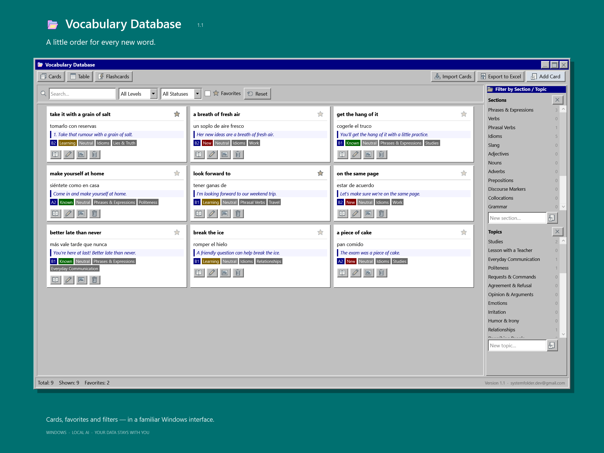
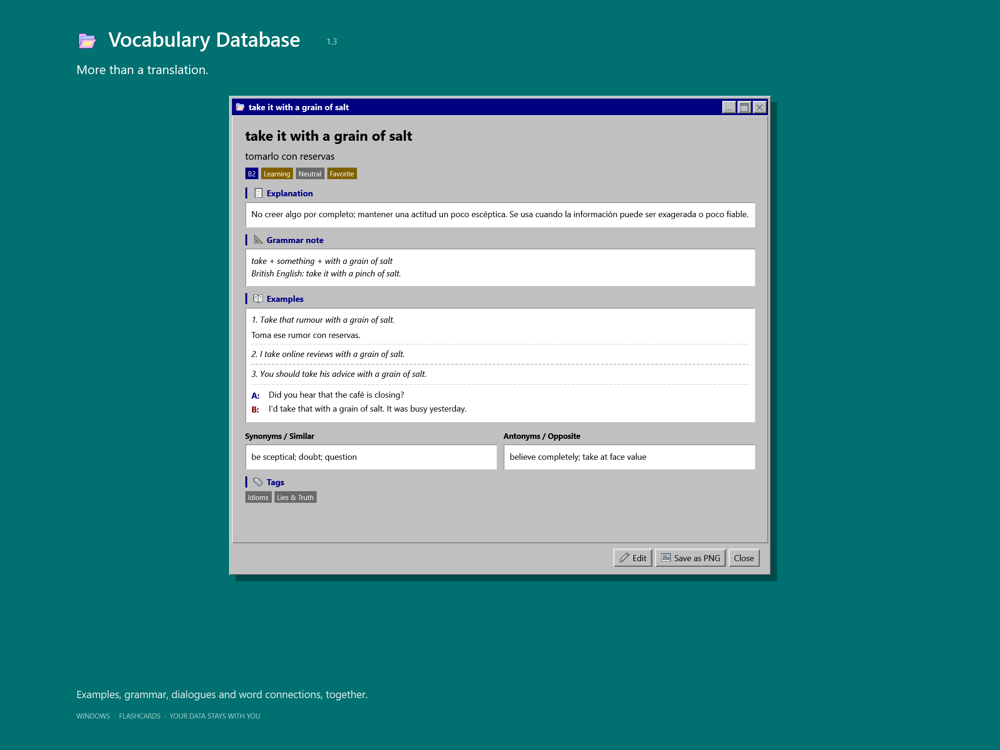
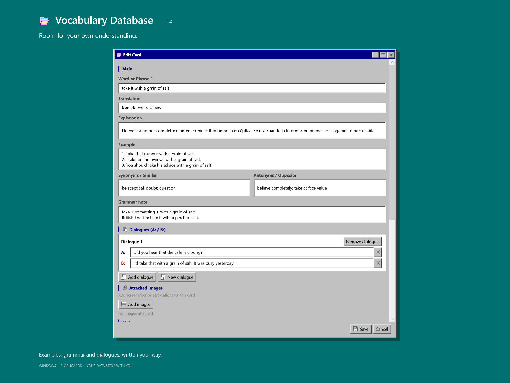
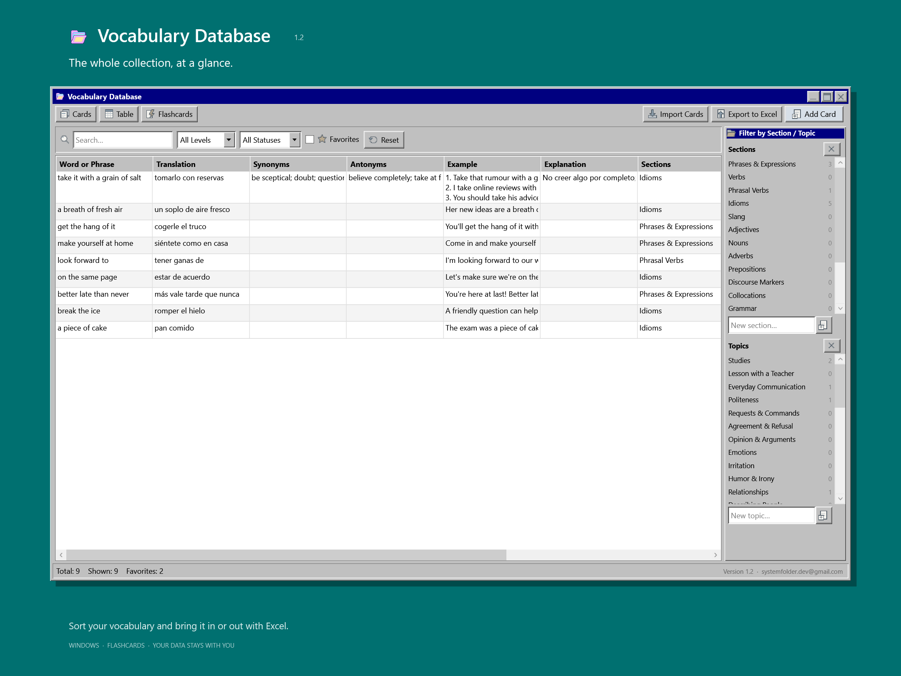
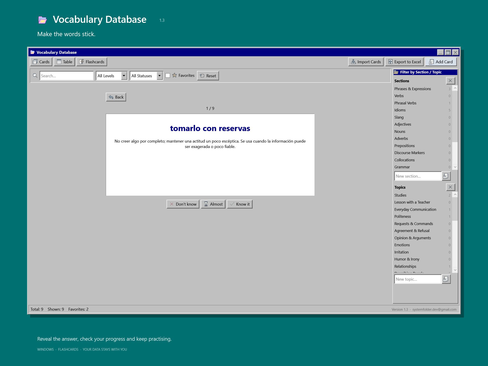

# Vocabulary Database

A Windows vocabulary manager with a classic interface, detailed study cards, flashcard practice and optional local AI. Current version: **1.1**.



## Download and install

1. Download [Vocabulary Database 1.1 for Windows](https://github.com/RitaBarbarita/vocabulary-cards/raw/refs/heads/main/Vocabulary-Database-Setup-1.1.exe).
2. Close the application if it is already running, then run the installer.
3. Choose the language for translations and explanations, then open **Vocabulary Database**.

Requires **Windows 10/11 x64** and **.NET Framework 4.8**. The interface is in English; study words can be in any language. The installer is unsigned, so Windows SmartScreen may display a warning.

Updating from English Vocab DB preserves cards, images, language settings and local AI files. Install over the existing version; uninstalling first is unnecessary.

## Features

- Cards with translations, explanations, examples, grammar notes, synonyms, antonyms, dialogues and images.
- Sections, topics, language levels, registers, learning status and favorites.
- Search, filters, a sortable table and flashcard practice.
- Excel `.xlsx` and `.xls`, CSV and pasted-table import with column matching and duplicate detection; Excel export.
- Individual card export as PNG, including long cards and A/B dialogues.
- Optional local AI filling with **Only empty fields**, **Stop** and **Undo**. Generated text is a draft; review it before saving.
- Centered card rows, incremental loading that keeps the scroll position and a **Back to top** button.

## Screenshots

<table>
<tr>
<td width="50%"><strong>Card details</strong><br></td>
<td width="50%"><strong>Card editor and local AI</strong><br></td>
</tr>
<tr>
<td width="50%"><strong>Vocabulary table</strong><br></td>
<td width="50%"><strong>Flashcard practice</strong><br></td>
</tr>
</table>

The screenshots show the actual version 1.1 interface with demonstration cards and Spanish translations. These cards are not installed with the application.

## Local AI

No API key or paid subscription is required. Select **Set up AI** inside the application to install its local Ollama runtime and Qwen3.5 9B model. Initial setup needs an internet connection, downloads up to about **8.1 GB**, and requires about **15 GB** of free disk space. The AI files are downloaded separately from the small application installer.

Version 1.1 fixes AI setup on a fresh computer: folders are created automatically, downloads are checked before installation, and interrupted setup can be retried without manual cleanup. Installing Ollama separately or copying folders from another computer is unnecessary.

After setup, card generation runs locally. Speed depends on available memory and GPU. Manual cards and study features work without AI.

## What changed in 1.1

- Renamed the application, installer, executable and shortcuts to **Vocabulary Database**.
- Updated the displayed version to **1.1** and file versions to **1.1.0.0**.
- Fixed local AI installation when its data folder does not yet exist, with verified downloads and retry after interruption.
- Preserved existing vocabulary, attachments, settings and models during upgrades.
- Cleaned and formatted the sources; removed unused imports, obsolete development scripts and redundant comments.

See the [changelog](./native/CHANGELOG.md) for details.

## Data and updates

Cards and images are stored locally in `%LOCALAPPDATA%\English Vocab DB\NativeData`. The old folder name is retained for compatibility with existing installations. AI files are kept in `%LOCALAPPDATA%\English Vocab DB\AI`.

To update, close the app and run the new installer over the existing version. Standard shortcuts are replaced with **Vocabulary Database** shortcuts. Uninstalling retains the vocabulary and AI files. The installer and source archive contain no personal vocabulary database, attachments or models.

The main interface uses C# and WPF. Microsoft Edge is used only for a one-time transfer from an older browser-based installation; the original browser profile is retained.

## Source and build

Source code, icons and build instructions are in [`native`](./native). A [source archive for version 1.1](https://github.com/RitaBarbarita/vocabulary-cards/raw/refs/heads/main/Vocabulary-Database-Source-1.1.zip) is also available.

On Windows, run:

```powershell
powershell -NoProfile -ExecutionPolicy Bypass -File native\build.ps1
```

The build downloads no packages. It writes `native\build\VocabularyDatabase.exe` and `outputs\Vocabulary-Database-Setup-1.1.exe`. Warnings are treated as build errors.

The packaged application passed **132 checks**: 38 application checks, 48 UI checks, 20 AI setup checks, 13 upgrade checks and 13 product name/version/shortcut checks. See the [verification report](./verification/1.1.json) and [test instructions](./native/README.md#verification). Tests use isolated folders and synthetic data; AI download tests use small HTTP fixtures. A full model download and a second physical computer were not tested in this run.

## Contact

Questions, feedback or bug reports: [systemfolder.dev@gmail.com](mailto:systemfolder.dev@gmail.com).
